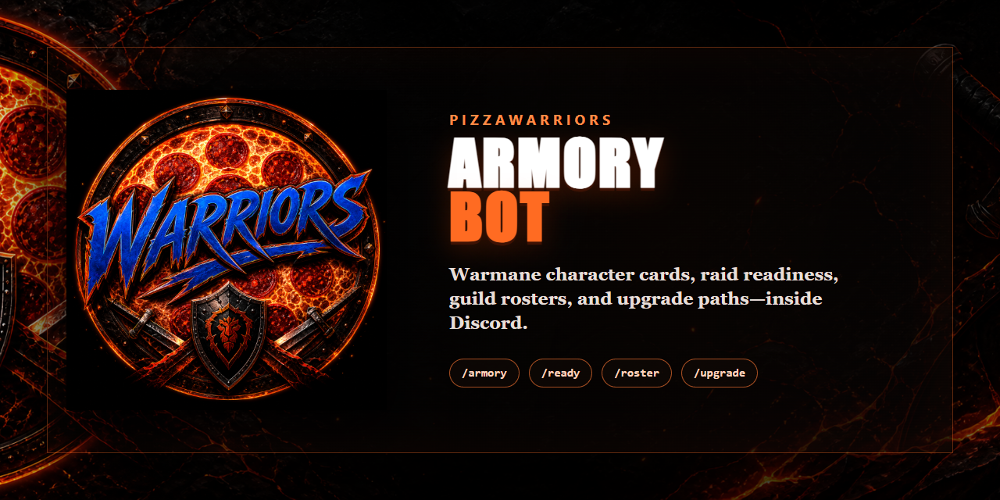
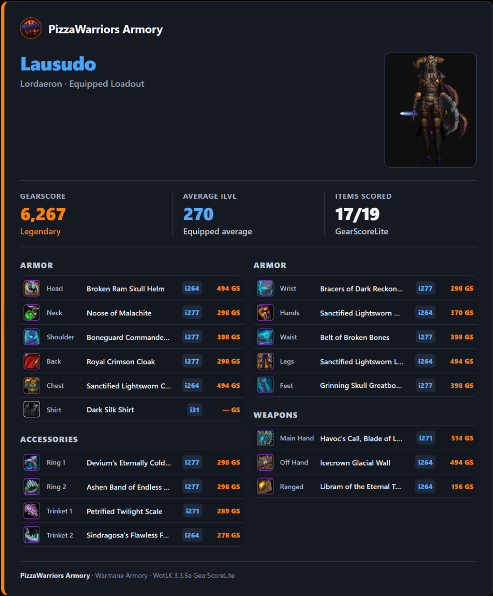

# PizzaWarriors Armory Bot

<p align="center">
  
</p>

<p align="center">
  <a href="https://github.com/CRSD-Lau/PizzaWarriors-Armory-Bot/actions/workflows/ci.yml"></a>
  
  
  
</p>

**A focused Discord armory and raid-readiness bot for Warmane characters.**

Look up a character with one slash command and receive a mobile-readable equipment card with real Warmane item icons, a live character render, average item level, and WotLK 3.3.5a GearScoreLite-compatible scoring.

<p align="center">
  
</p>

## What it does

- Posts `/armory name:<character> [realm]` results directly in Discord.
- Reads equipped slots and item icons from the Warmane Armory.
- Calculates WotLK 3.3.5a GearScoreLite, including Titan's Grip/two-hand handling.
- Generates branded equipment cards with GearScore tier colors, blue iLvl, and the Armory-reported current specialization.
- Includes an **Open Armory** link and a resilient text-embed fallback.
- Turns a live Raid-Helper event into a raid-readiness card with attendee GS, iLvl, and selected spec.
- Compares Raid-Helper responses with the configured **Pizza Core** role and can safely ping only current core members who have not responded at all.
- Includes a separately scheduled [weekly raid workflow](tools/pizza-raid-helper/references/operations.md): Raid-Helper signup creation, native Discord voice events, 30-minute reminders, and guarded end-of-raid rollover.
- Privately reports one completed-raid Pizza Core attendance window from final Raid-Helper rosters, using live final records or durable local archives.
- Browses the public Warmane guild roster in a branded 10-member Discord carousel.
- Plays music in your voice channel from YouTube searches/links and public YouTube or Spotify playlists. Spotify links are matched to YouTube recordings.
- Builds upgrade cards directly from the PizzaWarriors Best-in-Slot Google Sheet, with owned-versus-target equipment.
- Runs without a database, web dashboard, message-content intent, or continuous guild-member monitoring.

## Commands

```text
/armory name:Lausudo realm:Lordaeron
```

```text
/ready event:<Raid-Helper message link or event ID> realm:Lordaeron
/attendance weeks:8
/raider link name:Lausudo realm:Lordaeron
/roster guild:"Pizza Warriors" realm:Lordaeron
/upgrade name:Lausudo realm:Lordaeron spec:Protection
```

```text
/play query:<song name, YouTube link, or public Spotify link>
/queue
/nowplaying
/pause
/resume
/skip
/stop
```

Music joins the caller's voice channel and stays in one room at a time. Anyone in that room can control playback. All music replies are private, dismissible messages; the bot does not post song announcements to the channel. Playlist imports and the waiting queue are capped at 100 songs, and the bot leaves after 60 seconds with an empty queue or no human listeners. Queues are cleared on restart. `/stop` also cancels lookups still in progress. See [music setup and validation](docs/MUSIC.md).

`/ready` finds the current **Pizza Core ICC25** Raid-Helper post in the configured signup channel or forum, reads its public event endpoint, and checks every active signup—including non-core guests—against Warmane. Forum discovery checks active and recently archived posts, accepts only posts created by Raid-Helper, and uses the **PizzaCore** or **PizzaRaid** forum tag when available. An explicitly supplied event link still overrides automatic selection. If a member's Discord name is not their character name, they use `/raider link` once; the link is saved only on this host and only for this Discord server. Tentative, bench, and absent entries are excluded from the active readiness total and listed separately by name. When `PIZZA_CORE_ROLE_ID` is configured, the live **Pizza Core** role is refreshed on every `/ready`; see the [core-roster reminder guide](docs/CORE-ROSTER.md).

`/attendance` is an officer-only, ephemeral report over one window of completed Pizza Core raids. Upcoming and ongoing events are excluded. Each included raid prefers a final Raid-Helper roster fetched after completion, then its durable final-roster archive. If neither is available, an older saved attendance snapshot keeps that raid in the window with its original statuses and historical membership. Only raids with no usable record are omitted. The displayed count, date range, totals, and table always describe the same included records. Snapshot fallback does not create or overwrite a final archive.

The running bot discovers events automatically, saves core membership before the start, and archives the final roster after the raid ends. It checks every five minutes, allows a five-minute end grace period, and catches up after restarts. No manual `/ready` or `/attendance` run is required. Final archives are retained even when old Raid-Helper events disappear.

Attendance follows the raid leader's maintained Raid-Helper statuses: **Signed** and **Tentative** count as attended; **Late** and **Bench** mean did not attend; **Absent** is a declared absence; **Missing** is no call/no show. The **100% attendance** section requires a full nonempty displayed window containing only Signed or Tentative. Historical roster membership is preserved, so a member who was not on an older roster remains untracked (`—`) rather than being credited or penalized. The bot does not monitor gameplay or voice presence.

`/roster` defaults to **Pizza Warriors** on the configured realm. Its Previous and Next controls show ten characters at a time, while **Open Guild Armory** returns to the underlying public roster.

`/upgrade` loads its targets from the [PizzaWarriors Lordaeron Best-in-Slot List](https://docs.google.com/spreadsheets/d/1i5CFTZ8kIrISQzvNmJHx85smAYlkaCTO9q_UcsrcqqE/edit). The bot reads the selected class/spec column directly, caches it for five minutes, and links the exact class tab on every card. Update the sheet and the next fresh `/upgrade` request uses the new list—no code edit or bot restart is needed.

Supported realms are **Lordaeron**, **Icecrown**, and **Blackrock**. The configured default is Lordaeron. Anyone who can use the slash command may look up a public character; guild membership is intentionally not required.

## Requirements

- Node.js **24** or later
- Google Chrome (used in headless mode to render the card without opening terminal windows)
- A Discord application with a bot token and application ID

The bot needs only the `bot` and `applications.commands` invite scopes and the Discord **Guilds** and **Guild Voice States** gateway intents. Music also requires View Channel, Connect, and Speak in the target voice channel. Role-backed core tracking additionally requires **Server Members Intent** to be enabled for the application so the bot can call Discord's member-list endpoint on demand. The client does not subscribe to member gateway events or monitor messages. Ordinary armory/readiness commands do not require a Raid-Helper API key; the optional weekly raid publisher does. Manual core reminders and private attendance history are restricted to members with **Manage Events**, with runtime checks also accepting **Manage Server**.

## Quick start

```powershell
git clone https://github.com/CRSD-Lau/PizzaWarriors-Armory-Bot.git
Set-Location PizzaWarriors-Armory-Bot
npm ci
Copy-Item .env.example .env
notepad .env
npm run dev
```

Set `DISCORD_GUILD_ID` while testing so Discord registers the slash command in your server immediately. Without it, global command propagation can take time.

Required variables:

```dotenv
DISCORD_TOKEN=your-bot-token
DISCORD_CLIENT_ID=your-application-id
```

Set `RAID_HELPER_CHANNEL_ID` to the Discord **forum channel ID** containing the weekly Raid-Helper posts (or a legacy text-channel ID). This lets plain `/ready` select the nearest current or upcoming **Pizza Core ICC25** event and prevents a completed saved event or an unrelated forum post from being silently reused.

Set `PIZZA_CORE_ROLE_ID` to the **Pizza Core** role ID and enable **Server Members Intent** on the application's **Bot** page in Discord's Developer Portal. Role membership then becomes the live source of truth for `/ready`, manual reminders, and the current-core attendance view.

See [`.env.example`](.env.example) for the complete configuration reference. Never commit `.env`, a Discord token, or `WARMANE_COOKIE`.

## Production operation

The optional weekly publisher is versioned under [`tools/pizza-raid-helper`](tools/pizza-raid-helper/SKILL.md). It uses a separate Windows task and the same bot identity; it is not started by `npm start` or the Armory service installer below. Its committed profile contains synthetic IDs and no activation. See [setup, ownership, and recovery](tools/pizza-raid-helper/references/operations.md). Publishing or pulling this source does not migrate an existing installed scheduler or authorize a second one.

Production uses one persistent Windows Task Scheduler process. Run the installer
once from Administrator PowerShell; it removes the obsolete PM2 watchdog and
logon tasks, registers a single S4U task, and prevents parallel instances. The
task starts at boot and every minute indefinitely. `IgnoreNew` leaves a running
bot alone; a stopped or crashed bot starts at the next tick. The existing
one-minute failure retries remain enabled as well.

```powershell
.\scripts\install-boot-recovery.ps1 -StartNow
Get-ScheduledTask -TaskName "PizzaWarriors Armory Bot"
Invoke-RestMethod http://127.0.0.1:3000/healthz
```

Do not combine this task with a PM2 boot, logon, or repeating watchdog task.
The PM2 ecosystem file remains available only for deliberate interactive use.

To add recovery to an existing installation without stopping the bot or changing
its action/account, run `scripts/enable-auto-recovery.ps1` from Administrator
PowerShell. It backs up the task definition and verifies the saved trigger.

For maintenance or deployment, **disable the task before stopping it** so the
timer cannot start it while files or dependencies are being updated:

```powershell
Disable-ScheduledTask -TaskName "PizzaWarriors Armory Bot"
Stop-ScheduledTask -TaskName "PizzaWarriors Armory Bot"
# Complete maintenance, then:
Enable-ScheduledTask -TaskName "PizzaWarriors Armory Bot"
Start-ScheduledTask -TaskName "PizzaWarriors Armory Bot"
```

Recovery requires Windows to be awake. It restarts an exited process; it does
not terminate an existing process merely because Discord or Warmane is slow.
Keep the separate **Pizza Core Weekly Raids** task unchanged.

- `GET /healthz` returns `{ "ok": true }` for health probes.
- Complete item metadata is cached for 30 days in `.cache/items.json`; incomplete source responses retry after one minute instead of preserving placeholder values for a month.
- The bot admits one expensive operation per user and four in total. Additional requests receive a private busy response; `/armory` also has a ten-second user/server cooldown.
- Character summaries cache for five minutes, with bounded six-hour outage fallback. `/ready` labels stale gear and excludes it from freshly verified readiness.
- Private JSON writes are serialized and atomically replaced. Invalid files fail closed without being overwritten. Keep one bot writer and back up `data/`; atomic writes are not a backup system.
- If Warmane presents a Cloudflare challenge, `WARMANE_COOKIE` can be set from a browser session you control. Treat it as a password.

## Architecture

```text
Discord slash command
        │
        ▼
Warmane Armory ──► item metadata + equipped icons
        │
        ▼
WotLK GearScoreLite scorer ──► PizzaWarriors card renderer ──► Discord attachment

Raid-Helper event ID ──► public event signups ──► Warmane character links ──► raid-readiness card

PizzaWarriors Best-in-Slot Sheet ──► selected class/spec column ──► upgrade-target card
```

The bot uses the Warmane armory grid for the equipped position and icon, then enriches each item with type, level, and quality. The scoring rules are adapted from Pizza Logs' tested GearScoreLite implementation.

## Development and validation

```powershell
npm run typecheck
npm test
npm run test:raid-workflow
npm run test:cards
npm audit --omit=dev
```

CI runs the type, regression, workflow, and dependency checks on Node 24 for Windows and Linux. The optional `test:cards` smoke check requires local Chrome and renders all five card types from synthetic fixtures into `.cache/card-smoke`; it does not post to Discord. Review [the release checklist](docs/RELEASE-CHECKLIST.md) and [the September reliability review](docs/REVIEW-2026-09-06.md) before deploying.

## Security and privacy

- Secrets, runtime cache, and logs are excluded from Git.
- Rendered item-icon URLs are limited to HTTPS Warmane hosts and `wow.zamimg.com`.
- Character and item text is escaped before card rendering.
- No general Discord message content, voice activity, or gameplay attendance is stored.
- The configured core role is fetched for commands, officer reminders, and automatic pre-raid membership snapshots; the bot does not subscribe to guild-member gateway events.
- The optional roster-post link and reminder timestamps remain in ignored `data/core-rosters.json`.
- Private attendance data stores historical role/response snapshots in ignored `data/core-attendance.json` and durable final rosters in ignored `data/final-attendance.json`; `/attendance` replies are ephemeral.
- Optional `/raider link` entries contain only Discord user ID, character name, and realm in `data/raider-links.json`; the file is excluded from Git.

Read the [security policy](SECURITY.md) and the current [security review](docs/SECURITY-REVIEW.md) before hosting or contributing.

## Contributing

Contributions should stay focused on fast, dependable armory lookup and a clean Discord presentation. Start with [CONTRIBUTING.md](CONTRIBUTING.md).

## License

The source is published for transparent version history and review, but remains an internal PizzaWarriors guild utility. No license for reuse is granted; see [LICENSE](LICENSE) and the `UNLICENSED` package declaration.
